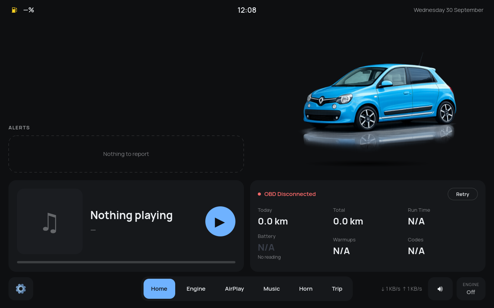
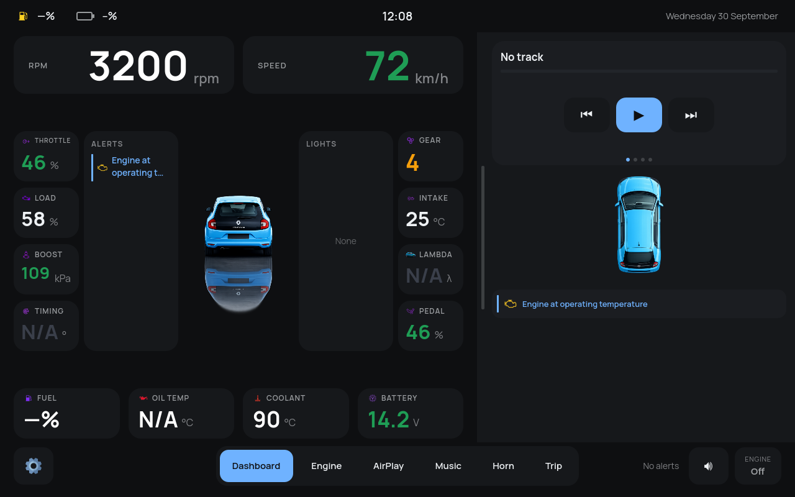
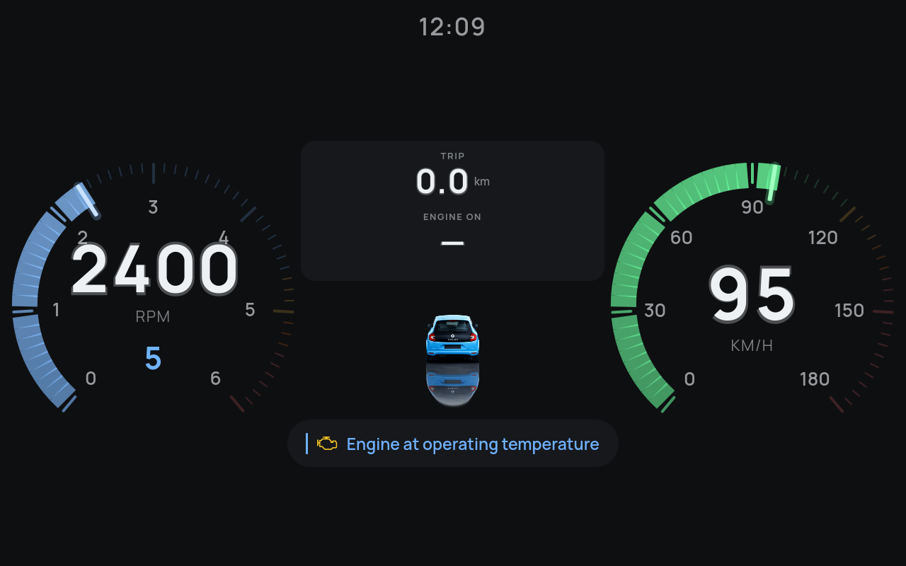
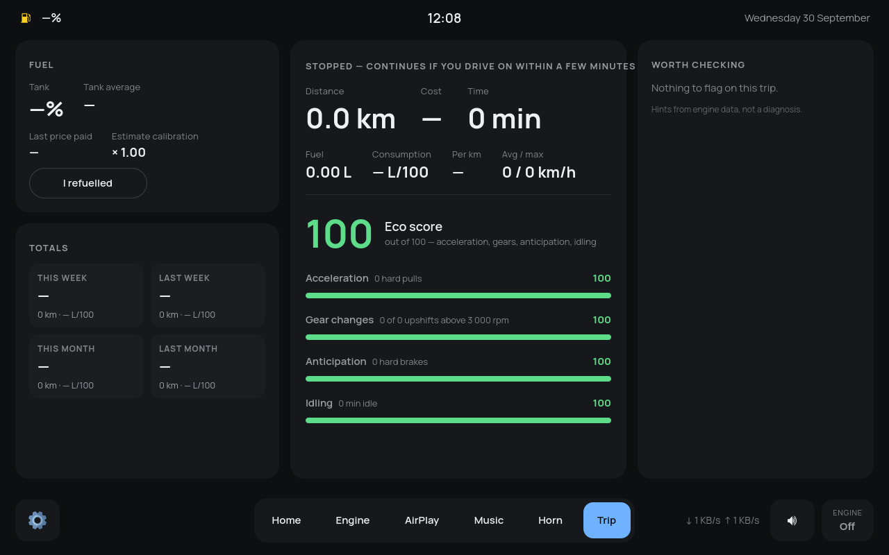
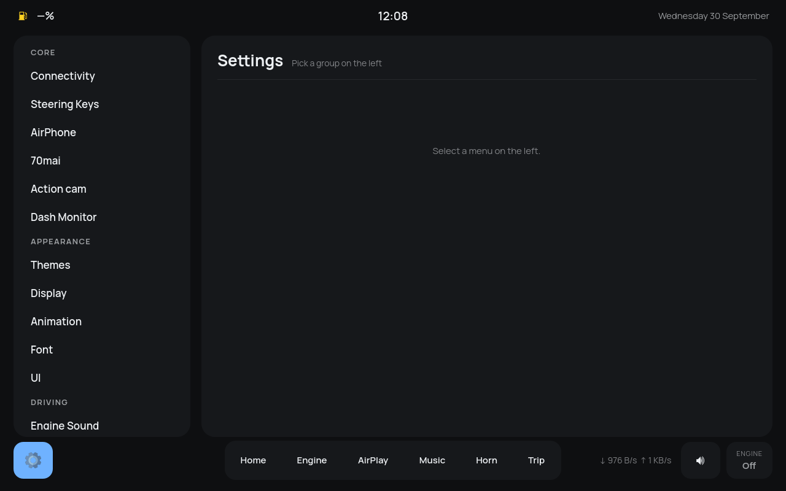

# LaLaDash (work in progress)

> **Work in progress.** LaLaDash is under active development and used daily on one car.
> Expect rough edges, unfinished pages and breaking changes between commits.

A touch dashboard for a car, built for a Raspberry Pi 4B on a 1280×800 panel.
PyQt6 + QML, with a Python backend for OBD-II / CAN telemetry, music with
lyrics, engine-sound simulation, trip and fuel tracking, and optional camera
pages. It was developed on a Renault Twingo III, which is the default
*reference vehicle*; nothing else is hard-wired to it (see below).

## Screenshots

Captured from a fresh clone on the dev PC: simulated telemetry, no OBD adapter,
no music library.



| Dashboard | Driving screensaver |
|---|---|
|  |  |
| **Trip** | **Settings** |
|  |  |

The car pictures are the reference vehicle's. Replace them with your own car's
images (see *Your car*).

## Quick start (dev PC)

```bash
pip install -r requirements.txt
python3 main.py
```

On first run `Data/settings.ini` is created from `Data/settings.default.ini`.
The Pi installer is `Installation/install.sh`; deployment helpers read your
host and key from `Installation/local.env` (copy `local.env.example`).

## Your car

Vehicle numbers (warning bands, gear ratios, tank size, engine model for the
fuel estimate) live in `Data/vehicles/default.json`. Copy it, edit it, and set
`[Vehicle] profile = <name>` in `Data/settings.ini`. See `Data/vehicles/README.md`.

The car pictures are `GUI/Icons/default_car.png` (side), `top.png` and `back.png`.
Drop in same-named PNGs with transparent backgrounds for your own car.

## Bring your own media

Copyrighted content is not part of this repository, and the folders below are
empty on a fresh clone. The app starts fine without them.

| Folder | What goes there |
|---|---|
| `Music/`, `Lyrics/`, `Stems/` | next to the repo folder, not inside it (`Data/music.example.json` shows the tag format) |
| `Cars/` | engine-sound packs, see `Cars/README.md` |
| `Sounds/` | soundboard clips, see `Sounds/README.md` |

## Layout

`main.py` bootstraps QML and the bridges in `bridges/`; `Styles/Modern/` is the
UI; `Modules/` holds the backend. `docs/ARCHITECTURE.md` documents the architecture.
The QWidget-era files in the repo root are legacy and not loaded.

## License

GPL-3.0-or-later, see `LICENSE`. Bundled third-party pieces are listed in `THIRD_PARTY.md`.
